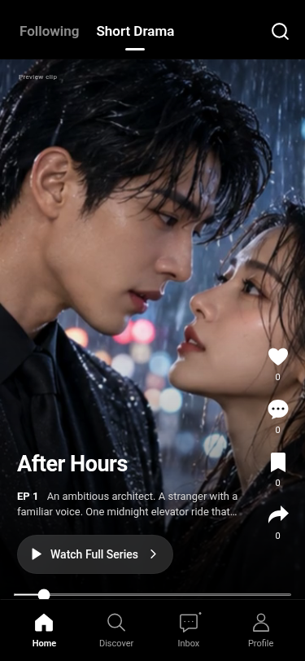

# PrimeDrama 实际界面截图

最新调整：首页四个互动图标白色实心、间距缩小；移除左上角暂停/静音图标；各页共用1.6细线导航，首页选中项白色实心；发现页只保留顶部分类和连续双列海报，封面无播放按钮和角标，剧名与更小的灰色简介位于图片下方。声音开关位于选集面板。

云端 Chromium 运行截图，可在 GitHub 打开；图片不是可交互网站。保留 VIP：前 N 集免费、Basic含广告、Premium无平台广告，PayPal未开通。

| 页面 | 截图 |
| --- | --- |
| Home 黑色9:16播放器 | [手机首页](primedrama-home.png) |
| Discover 白色4:5双列海报 | [手机发现页](primedrama-discover.png) |
| Inbox | [通知](primedrama-inbox.png) |
| Profile | [个人页](primedrama-profile.png) |
| VIP | [会员](primedrama-vip.png) |
| 电脑适配 | [电脑发现页](primedrama-desktop.png) |

[中文使用说明](../使用说明.md) · [公网部署步骤](../公网部署.md)

其余旧版 Afterglow 截图保留，不代表新版设计。
